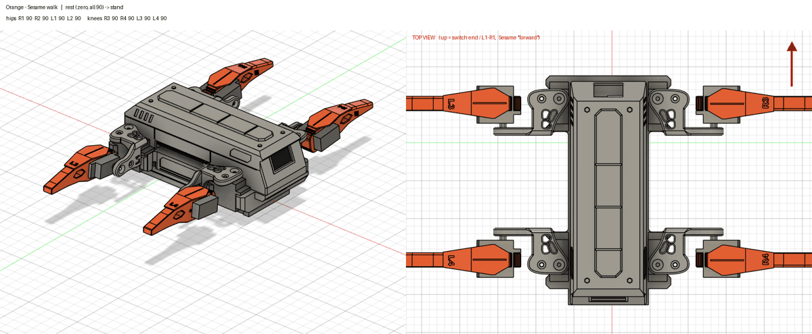
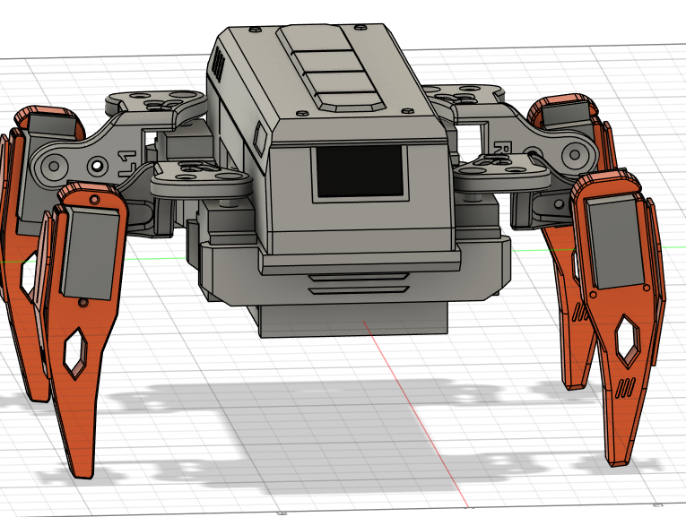
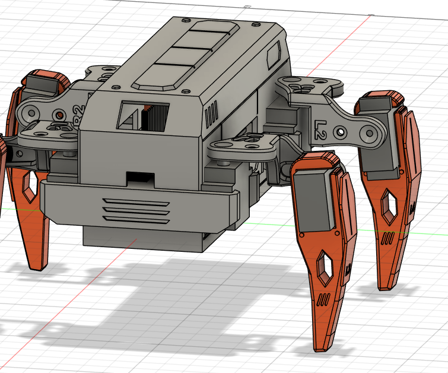
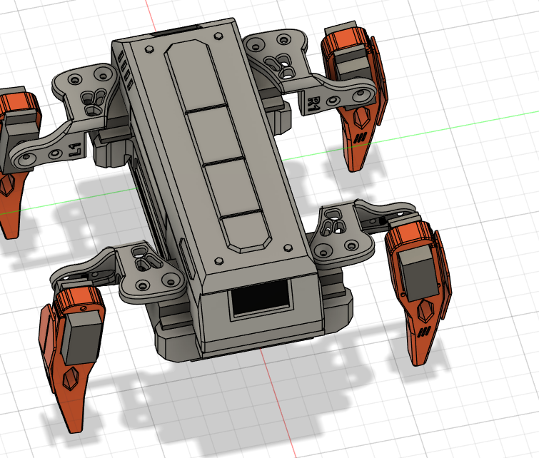
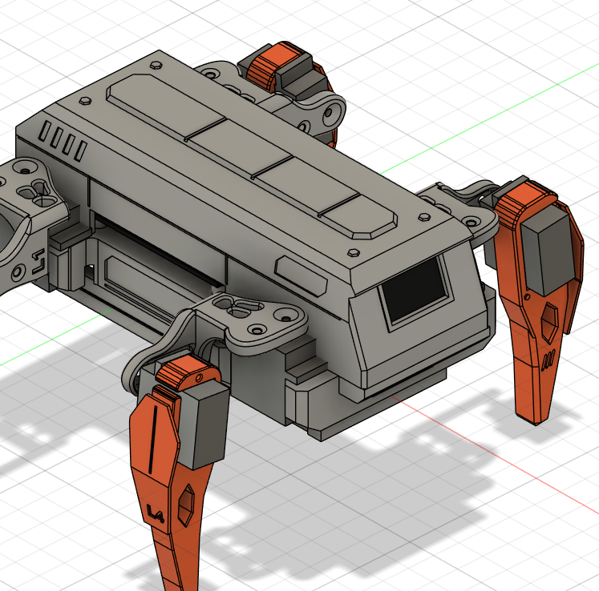
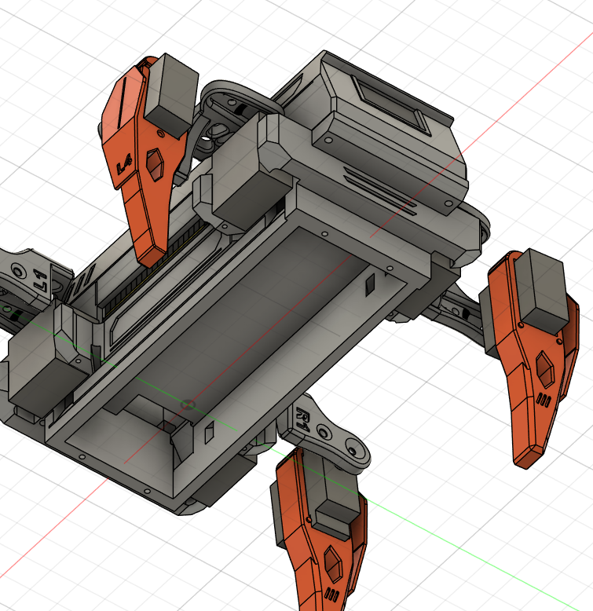
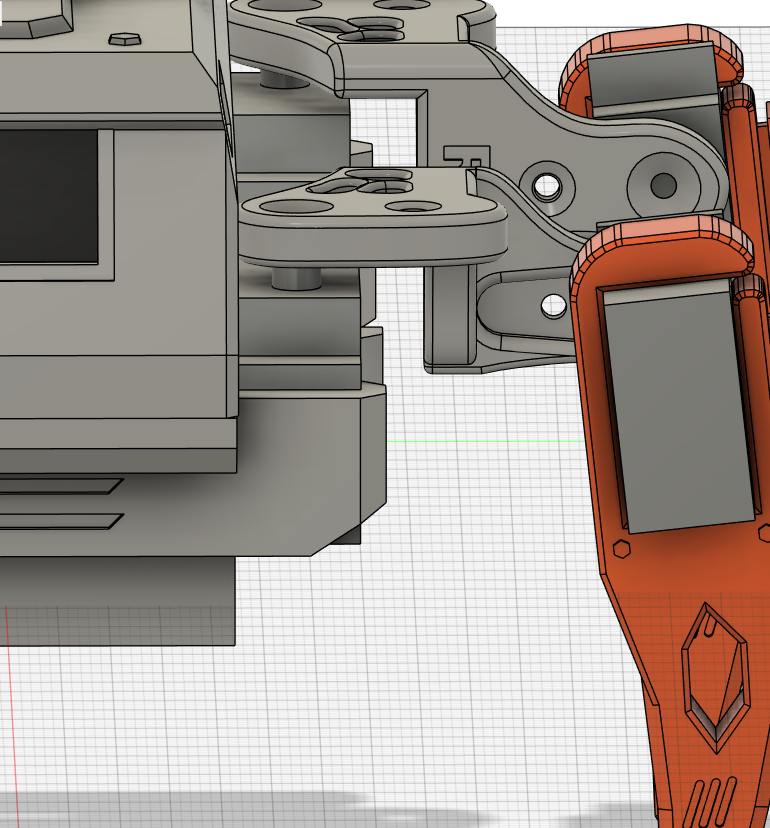
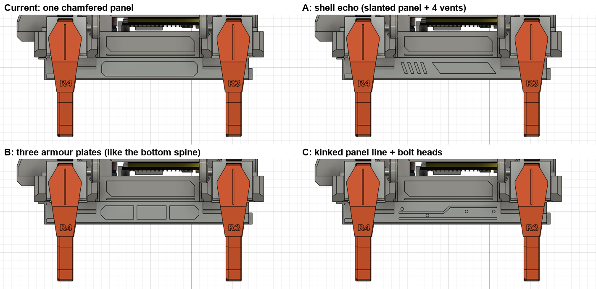
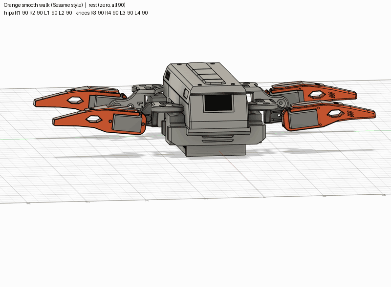
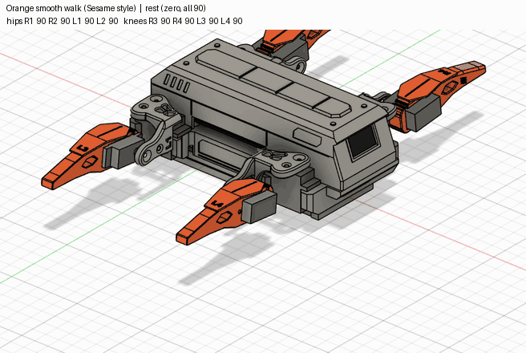

# Orange 2.0

### A 3D-printed quadruped robot — 8 × MG90S servos, an ESP32 and a 2S LiPo

Editable Fusion sources, print-ready STLs, a clash-checked walking gait,
and the Python that built every part.

 

 

<b>Walking, from two angles at once — perspective and top view.</b> This is Sesame's original gait (<code>runWalkPose</code>) replayed on Orange's real CAD. Orange's own smooth gait is <a href="#walking-animation">further down</a>.

 

---

<table>
  <tr>
    <td align="center" width="33%" valign="top">
      
       <b>Front</b>
       OLED window, visor, 15 mm longer nose
    </td>
    <td align="center" width="33%" valign="top">
      
       <b>Back</b>
       Rocker-switch window and rear vents
    </td>
    <td align="center" width="33%" valign="top">
      
       <b>Top</b>
       Spine panels, 4 hips, labelled legs
    </td>
  </tr>
</table>

<table>
  <tr>
    <td align="center" width="33%" valign="top">
      
       <b>Side</b>
       Mecha top shell, panel lines, hip servos
    </td>
    <td align="center" width="33%" valign="top">
      
       <b>Bottom</b>
       Battery bay, deck, servo-cable tunnels
    </td>
    <td align="center" width="33%" valign="top">
      
       <b>Leg joint</b>
       Hip horn, knee plate, blade shin
    </td>
  </tr>
</table>

 

| At a glance | |
|---|---|
| **Body** | 150.9 × 82.1 × 30.0 mm base · 147.2 × 49.9 × 36.0 mm top shell |
| **Legs** | 49.5 mm upper · 77.7 mm lower · 4 upper-leg styles to choose from |
| **Motion** | 8 DOF — 4 hips, 4 knees · hip swing kept under ±25° |
| **Brain** | ESP32 38-pin, XL4015 buck, servo perfboard on its own shelf |
| **Display** | 0.96" I²C OLED behind a 22.45 × 12.5 mm window |
| **Fasteners** | 16 × M2 self-tapping, plus the servos' own screws |

---

[**What's in the repo**](#whats-in-the-repo) · [**The parts**](#the-parts) · [**What changed from v1**](#what-changed-from-v1) · [**Base width**](#base-width)

[**Bottom cover**](#bottom-cover) · [**Skirt cover**](#skirt-cover) · [**Walking animation**](#walking-animation) · [**Electronics layout**](#electronics-layout) · [**Display**](#display)

[**Screws**](#screws) · [**Printing**](#printing) · [**Assembly order**](#assembly-order) · [**Measurements used**](#measurements-used) · [**Running the scripts**](#running-the-scripts) · [**License**](#license)

---

## What's in the repo

| Folder | What's in it |
|---|---|
| `fusion/<part>/` | CAD files. The `.f3d` files are the full editable **Fusion designs** (timeline and sketches). Open them with Fusion → File → Open → Open from my computer. The `.step` files open in any CAD program. |
| `stl/<part>/` | Ready-to-print STL files. |
| `media/` | Walking-gait animations (GIF), gait angles (CSV), the renders above and a render of the bottom-cover options. |
| `scripts/` | The Python scripts used to build, check and animate the parts. See [`scripts/README.md`](scripts/README.md). |
| `fusion/_superseded/`, `stl/_superseded/` | Older versions kept for reference. Don't print these. |

Part folders (the same names under `fusion/` and `stl/`):

- `top_shell/`
- `base_battery_holder/`
- `perfboard_shelf/`
- `bottom_cover/`
  - `standard/`
  - `skirt/`
- `lower_leg/`: one file per leg (L3, L4, R3, R4), plus an unlabelled copy.
- `upper_leg/`
  - `tactical/`
  - `bone_single_hole/`
  - `bone_two_holes/`
  - `bone_multi_hole/`

  Each style has L1, L2, R1 and R2.
- `assembly/`: CAD only. The whole robot with and without legs (`.f3d`), and as `.step`.

The full parts guide follows below: printing, screws, assembly order and display mounting. File names in it are the same as in these folders.

---

## The parts

Version 2 of Orange's body. The body is **15 mm longer at the front**, so the display and rocker switch have room. The electronics are now held by printed posts and a shelf instead of being squeezed in and zip-tied.

| File | What it is | Size (mm) |
|---|---|---|
| `Orange_TopShell_v2.stl` / `.step` | Top shell (mecha style), 15 mm longer at the front | 147.2 × 49.9 × 36.0 |
| `Orange_Base_BatteryHolder_v2.stl` / `.step` | Base: battery holder, servo brackets, deck with mounts. Top part widened 1.5 mm per side (2026-11-06), see "[Base width](#base-width)" | 150.9 × 82.1 × 30.0 |
| `Orange_PerfboardShelf_v2.stl` / `.step` | Separate shelf that holds the servo perfboard above the ESP32 | 65.5 × 17.7 × 10.9 |
| `Orange_LowerLeg_v2_L3/_L4/_R3/_R4.stl` / `.step` | Lower leg, **one file per leg** (print 1 of each): faceted blade shin, your front shield, aerospace details, leg name engraved on the shield | 20.0 × 21.2 × 77.7 |
| `Orange_LowerLeg_v2.stl` / `.step` | The same lower leg without a label (older export, kept for reference) | 20.0 × 21.2 × 77.7 |
| `Orange_UpperLeg_Tactical_v2/` | Upper leg, tactical style (triangle windows): `…_L1/_L2/_R1/_R2.stl` / `.step`, **one file per leg** | 20.3 × 30.5 × 49.5 |
| `Orange_UpperLeg_Bone_v2/` | Upper leg, organic "bone" style, 3 designs in subfolders (pick one): `…_SingleHole` (teardrop), `…_TwoHoles` (two curved slots), `…_MultiHole` (three cells). Each has `…_L1/_L2/_R1/_R2.stl` / `.step` | 20.3 × 30.5 × 49.6 |
| `Orange_BottomCover_v2/` | Removable bottom cover (`Orange_BottomCover_v2.stl`), its 6 cosmetic inlay pieces (`…_Cosmetic_Spine1–4`, `…_StripeL/R.stl`), and a STEP with everything in place. See "[Bottom cover](#bottom-cover)" | 130.8 × 51.4 × 13.6 |
| `Orange_BottomCover_Skirt_v2/` | **Extra, alternate** bottom cover with side skirts that fill the strip under the body between the hip servos (armour-plate design). Same latch, slots and cosmetic pieces as the regular cover. See "[Skirt cover](#skirt-cover)" | 130.8 × 52.6 × 13.7 |
| `Orange_Assembly_v2.step` | Whole robot standing (updated 2026-11-06): the widened base, top shell and shelf, the ESP32, buck, perfboard and OLED models, 4 hip + 4 knee MG90S envelope blocks, the 4 Bone MultiHole upper legs and the 4 labelled lower legs. The older no-legs version is in `superseded/` | — |

All the STLs are single watertight parts with no bad edges. The same designs are saved in the Fusion **hexa** project under the same names.

---

## What changed from v1

- **Top shell:** the nose is 15 mm longer. The display window, visor, front screw posts, front hex bolts and front side panels moved forward with it. The rear, the rocker switch window and the side notches are unchanged.
- **Display window:** the same size and cut as the old Orange (22.45 × 12.5 mm, centered), with the same visor frame. **New:** 4 flat pads inside the front wall to mount the OLED (see "[Display](#display)" below).
- **Base:** only the **top plate** grew, as a 6 mm thick nose flush with the deck. These are **unchanged**:
  - the battery cavity (114 × 40 × 22);
  - the battery walls;
  - the 4 servo brackets;
  - the servo plug tunnels;
  - the XT60 hole.
- **Base mounts (new):**
  - 4 posts for the ESP32 (Ø5 × 4 mm);
  - 4 posts for the buck (Ø5 × 2 mm);
  - 2 screw holes and a socket for the shelf.
- **Perfboard shelf (new part).**
- **Moved for the longer nose:** the top shell's 2 front screw holes in the base moved forward 15 mm. The top front vent slot on the base was removed so it doesn't cut into the nose.

---

## Base width

*Changed 2026-11-06.*

The top part of the base (the block above the battery, the deck and its nose) is **1.5 mm wider on each side**, 3 mm in total. This moves the upper legs away from the top shell.

- **Moved out 1.5 mm with it:** the 4 servo brackets (same size and shape as before), their screw holes and the hip servos. The servos still sit flush against the base side.
- **Unchanged:**
  - the battery tube and battery bay (114 × 40 × 22);
  - the XT60 outlet;
  - the 4 servo-plug tunnels;
  - the top-shell screw holes, so the top shell fits exactly as before;
  - the ESP32, buck and shelf mounts.
- **Only other change:** the servo wire slots under the deck are 1.5 mm longer, to reach the moved brackets.
- **Clearance with the bone upper legs:**

  | Hip angle | Upper leg to top shell |
  |---|---|
  | Standing | 1.07 mm |
  | Swung up to 20° | 0.87 mm or more |
  | Past about 25° in one direction | the leg touches the shell |

  Keep the hip swing in your walking code under about 25°, or widen the base more.
- The previous (narrower) export is kept in `superseded/` for reference.

  
   The hip horn, knee plate and blade shin — where that 1.5 mm of clearance lives.

---

## Bottom cover

*Added 2026-11-06.*

The cover holds the battery in the bay. You can remove it without tools to take the battery out for charging.

  
   The underside: battery bay, deck and the servo-cable tunnels the cover has to clear.

**How it attaches:** like a TV-remote battery door.

- **Rear (switch end):** a tongue on the cover slides into a 14 mm slot in the base's rear wall.
- **Front:** a springy arm with a square-bottomed hook snaps into a 12 mm pocket in the base's front wall, just under the nose. The hook's flat underside sits on the pocket floor, so the cover can't fall or be pulled off. The weight of the battery only presses it in harder.
- **Sides:** low walls hug the battery tube, so it can't shift sideways.

**Closing:**

1. Slide the battery in.
2. Hook the rear tongue into its slot.
3. Swing the front up until the latch clicks.

**Opening:** push the small pull tab at the front forward (toward the nose). The hook lets go and the cover swings down on its tongue.

**Optional screws:** 4 countersunk holes line up with the base's existing M2 pilot holes. Add 4 × M2 × 8 screws if you want it permanently locked. These are not in the 16-screw list above.

**Cosmetic inlays:**

- **Slots:** the outside face has 2.0 mm deep engraved slots, a 4-segment spine down the middle like the top shell's panels and 2 slanted side stripes.
- **Pieces:** the 6 `…_Cosmetic_*.stl` pieces are 2.0 mm thick and 0.15 mm smaller than their slots all round.
- **Assembly:** print them in an accent color and glue them in with superglue or a drop of epoxy. They sit exactly flush, so the bottom stays flat on the ground.

**Printing:**

- **Cover:** outside face down. The slots print as open pockets on the bed side and the plate bridges over them. No supports. PETG is recommended, because the latch arm flexes every time you open it. PLA works but the arm tires sooner.
- **Cosmetic pieces:** flat, 100% infill.

**Base changes for the cover:**

- **New:** the two small pockets in the battery tube's end walls (rear slot and front latch pocket). The previous base export is in `superseded/`.
- **Unchanged:** the bay, tunnels, screw holes and everything else.

**Checked:**

- **Closed:** 0 overlap with the base. The whole battery opening is covered and the battery rests on the cover.
- **Engagement:** the hook goes 1.1 mm into its pocket and the tongue 1.2 mm into its slot.
- **Closing swing:** simulated. Only the latch snap touches on the way up.
- **Cables:** all 4 servo-cable tunnel exits stay clear.
- **Full robot assembly:** no clashes.

---

## Skirt cover

*Extra, added 2026-11-06.*

An optional second cover. The regular `Orange_BottomCover_v2` stays the main one; print this one if you want the sides of the robot closed off. Both fit the same base, and you swap them the same way.

  
   The skirt panel designs that were compared — <b>B, three armour plates</b>, is the one that shipped.

**What's different:**

- **Side skirts:** fill the strip below the body between the rear and front hip servos (x −7.0 to 58.4), flush with the body sides and stopping 0.2 mm under the body. Under the servos the cover stays slim, like the regular one.
- **Armour plates:** each skirt has 3 recessed plates, 0.6 mm deep, with the outer corners chamfered like the spine on the bottom. The wall behind them is 1.6 mm.
- **Sides of the plate:** flush with the body sides along the whole length (the regular cover sits 0.6 mm inside them).
- **Same as the regular cover:** rear tongue, front square-hook latch and pull tab, the 4 optional screw holes, and the 2 mm inlay slots. The 6 `…_Cosmetic_*.stl` pieces are identical to the regular cover's, so one printed set fits either cover.

**Printing:** same as the regular cover, outside face down. The skirts print as straight vertical walls, no supports.

**Checked:**

- 0 overlap with the base; it touches only at the tongue and latch.
- 5.4 mm clear of the hip servos, 1.4 mm clear of all 4 servo-cable tunnels.
- The legs stay at least 22 mm away through the whole Rest → Stand → walk → Stand → Rest motion.
- The cosmetic pieces sit in their slots with 0 overlap.

---

## Walking animation

*Added 2026-11-06.*

<table>
  <tr>
    <td align="center" width="50%" valign="top">
      
       <b>Smooth walk — front</b>
       <code>Orange_Walk_Smooth_front.gif</code>
    </td>
    <td align="center" width="50%" valign="top">
      
       <b>Smooth walk — angled</b>
       <code>Orange_Walk_Smooth.gif</code>
    </td>
  </tr>
</table>

Sesame's original walk, for comparison, is the two-angle animation <a href="#orange-20">at the top of this page</a>.

| File | What it is |
|---|---|
| `Orange_Walk_Smooth_front.gif` | The smooth walk, from your camera angle with the grid |
| `Orange_Walk_Smooth.gif` | The same walk from a fixed angled view |
| `Orange_Walk_Smooth_angles.csv` | All 8 servo angles for every frame (Sesame numbering: R1 R2 L1 L2 hips, R3 R4 L3 L4 knees) |
| `Orange_Sesame_Walk.gif` | Sesame's original walk (`runWalkPose`) replayed on Orange, for comparison |

- **Sequence:** Rest (zeroed, all 90°) → Stand → 3 step cycles toward the display end → Stand → Rest.
- **Pairs:** the same diagonal pairs as Sesame (R1+L2, then R2+L1), so 2 or 4 feet are always on the ground.
- **Hips:** they swing ±20° around Sesame's Stand angles: R1/L2 between 115° and 155°, R2/L1 between 25° and 65°. No hip turns toward the body middle, so the upper legs never reach the top shell.
- **Knees:** they lift 35°, in a smooth arc of about 12 mm.
- **Checked:** no clashes in any frame, between the legs and the body, the top shell, the servos and each other.
- **Not simulated:** this is motion only. Balance, weight and foot slip aren't covered.
- **Angle mapping:** the same as Sesame's angle diagram. Hip 90° = leg straight out sideways; knee 0°/180° = lower leg straight down, 90° = horizontal.
- **Scripts:** everything needed to regenerate or tweak the walk is in [`scripts/`](scripts/) (see its README).

---

## Electronics layout

  
   Everything below lives under this shell — boards on posts, perfboard on its own shelf.

| Part | Where | How it's held |
|---|---|---|
| ESP32 38-pin (55 × 30) | Upside down (module facing the deck), middle and rear of the deck, left side. Female jumpers point up | 4 posts, 4 × M2 |
| XL4015 buck (55 × 25 × 18) | Flat at the front, between the two front servo exits | 4 posts, 4 × M2 |
| Servo perfboard (60.5 × 19) | On the shelf above the ESP32, between its two jumper rows. **Servo plugs face the front** | Shelf, 2 × M2 |
| OLED 0.96" I2C, 4-pin, white | Behind the front window, glass pressed against the inside of the wall, **pins at the top** | 4 flat pads + glue |

Fusion's interference check finds **0 clashes** between the boards, the OLED, the shelf, the base and the top shell. The highest servo plug ends 1.3 mm below the roof.

**Not modelled** (you're handling these): the rocker switch and the XT60.

---

## Display

*0.96" OLED.*

  
   The 22.45 × 12.5 mm window and its visor frame, on the 15 mm longer nose.

- **Window:** 22.45 × 12.5 mm, the same as the old Orange. The glow area shows through it, and the glass rests flat against the inside of the front wall.
- **Mount:** 4 flat pads (Ø6 × 1.2 mm) on the inside of the front wall, at the module's mounting holes. They're placed for your measured hole spacing: 25 × 27 mm edge to edge, about 22.5 × 24.5 mm center to center.
- **Fixing it, with pins at the top:**
  1. Hold the module against the window from inside, glass toward the window, board resting on the 4 pads.
  2. Look through the window from the front and slide the module until the glow area is **exactly centered**.
  3. Put a dab of **hot glue (or epoxy)** where each corner of the board meets its pad.

  You align it by eye, so a ruler error of ±1 mm doesn't matter. The pads are Ø6 for that reason.
- **Clearances:**
  - the board's top edge clears the roof by about 0.7 mm (it just touches if the board is 1 mm bigger than measured);
  - the 4 wires run back above the buck.
- **Wiring:** **no header pins.** Solder the 4 wires (GND, VDD, SCK, SDA) **directly into the pads** from the back of the board, and keep the solder joints flat. They need only about 3 mm behind the board.

---

## Screws

*All M2.*

Use **M2 self-tapping screws for plastic** (PT / "plastite" type). The pilot holes are Ø1.7.

| Qty | Screw | Where |
|---|---|---|
| 2 | **M2 × 20** | Top shell → base, **rear** pair. From below, through the base, into the shell's screw posts |
| 2 | **M2 × 10** | Top shell → base, **front** pair. From below, through the 6 mm nose |
| 4 | **M2 × 6** | ESP32 → its 4 posts (from the top, through the board) |
| 4 | **M2 × 6** | Buck → its 4 posts |
| 2 | **M2 × 8** | Shelf rear leg → deck (head sits in the counterbore) |
| 2 | **M2 × 5** | Perfboard → shelf posts |
| 8 | servo screws | MG90S servos → brackets (the screws that came with the servos) |

**Total: 16 × M2** (2 × 20, 2 × 10, 8 × 6, 2 × 8, 2 × 5) plus the servo screws.

Notes:

- The ESP32's corner holes sit right next to its first pins. A standard M2 pan head (Ø3.8) can just touch the pin header's plastic. If it does, use small-head M2 screws or 2 mm plastic rivets.
- Printed holes come out slightly small. If a screw won't go in, open clearance holes with a **2.3 mm** drill and pilot holes with **1.6 mm**.
- Don't use longer screws than listed. The deck above the battery bay is only about 4 mm thick, and the pilot holes stop about 1 mm above the bay.

---

## Printing

General: PLA or PETG, 0.2 mm layers, **4 walls**, 25–30 % infill. 4 walls matters for the brackets and screw posts.

### Base: `Orange_Base_BatteryHolder_v2.stl`

- **Orientation: deck side up** (battery bay opening on the bed). The new posts are on top of the deck, so it can't be printed upside down like v1.
- **Supports: "touching build plate only" (tree supports work well)**, needed under:
  - the front nose (its underside is about 20 mm above the bed);
  - the 4 servo brackets and the end blocks (their sloped undersides);
  - the bracket underside overhangs.
- The battery bay ceiling bridges the 40 mm bay. Most printers handle that without support. Turn on bridging settings if yours has them.
- The servo plug tunnels are at about 63°, so they print without support.

### Top shell: `Orange_TopShell_v2.stl`

- **Orientation: open side down** (bottom rim on the bed).
- **Supports:** tree supports **inside** for the roof (about 41 mm span). Nothing is needed on the outside. The display window is on a 20° slant and the switch window on a 45° face, so both print cleanly.

### Perfboard shelf: `Orange_PerfboardShelf_v2.stl`

- **Orientation: as it's installed** (legs down, plate up). Its legs and perfboard posts point opposite ways, so it can't lie flat.
- **Supports: under the plate** (touching build plate). The plate is only 1.5 mm thick, so use **100 % infill** or enough walls to make it solid.

### Lower leg: `Orange_LowerLeg_v2_L3.stl`, `_L4`, `_R3`, `_R4` (print 1 of each)

- All four lower legs are the same shape as the original L3/L4/R3/R4. The only difference between the four files is the label.
- **Label (added 2026-11-06):** the leg name (L3, L4, R3 or R4) is **engraved 0.5 mm deep** on the lower, sloped part of the front shield. It reads upright when you look at the shield from the front.
  - Font: Arial Black (bold), 3.8 mm tall.
  - **Why it's this small:** the label sits where the shin is directly behind the shield, so there's 4.5 mm of solid under it. That spot is only 7.9 mm wide. The rest of the shield is a 1 mm plate, where a 0.5 mm engraving would leave only 0.5 mm.
  - **Checked:** each file is one watertight part, and nothing outside the label changed (servo window and screw holes identical to the unlabelled leg).
  - **Small details:** the sharp inside corners of some letters (the small triangle in the "4", the notch tips of the "3") come to points narrower than a nozzle, so they print slightly rounded. That's cosmetic only.
  - In Fusion, the label is the text in sketch `leg_label` (feature `LegLabel`). Change the text there to make another variant. The saved version has "L3".
- **Unchanged from the original:**
  - the servo window (12.49 × 22.97);
  - the 2 servo screw holes, Ø1.74 at the same positions. **Changed 2026-11-06:** they now go all the way through, where before they were 8.5 mm deep from the inner face. L4 and R3 are mounted turned over (shield facing out), so their servo tabs sit on the outer face and the screws go in from that side. The old blind-hole exports are in `superseded/`;
  - the servo-wire slot at the top;
  - the foot tip position and the overall length (77.7 mm), so the stance and walking code are unaffected.
- **The shield sticks out about 5 mm past the flat inner face** (the side that faces the upper link), as in your own design. So the leg can't lie flat on that face anymore:
  - **Option A:** lie it on the inner face and let the slicer support everything under it (tree supports, "everywhere"). This is the simplest, but the whole inner face prints on supports.
  - **Option B:** stand it on the shield's flat front face. That gives a big flat contact, with supports only under the overhanging parts of the shin.
  - Check the slicer preview and pick whichever leaves cleaner supports.
- **Walls:** 4 walls; the shield is 1 mm thick, so it prints as solid perimeters.
- **Before printing all 4:** fit one leg and move the knee through its full range, to check that the upper link (L1) clears the inner edge of the shield.

### Upper leg: `Orange_UpperLeg_Tactical_v2/` or one of the `Orange_UpperLeg_Bone_v2/` designs (print 1 of each: L1, L2, R1, R2)

- **Pick one style** and print its 4 files. All of them fit the same way.
- **Which file is which:**
  - **R2** is the same shape as L1;
  - **L2 and R1** are L1 mirrored top-to-bottom, as on your original legs;
  - only the engraved name differs within a pair.
- **Unchanged from the original L1/L2/R1/R2:**
  - both servo-horn pockets (hip and knee), including their depths and lead-in rounding;
  - the 4 horn screw holes and their countersinks;
  - the plate thicknesses (5.08 mm), so the hip and knee servos sit exactly where they did.
- **Knee swing:** checked against the new lower leg. It moves -180° to +92°, the same as with the original upper leg.
- **Label:** the leg name is **engraved 0.5 mm deep** on the outer face of the slim hip arm, in Arial Black, 4.5 mm tall. It reads correctly from outside, never mirrored.
  - **Tactical:** the name runs along the arm, in the solid area beside the hip horn, where your original labels were.
  - **Bone designs:** that area is cut away, so the name runs across the arm, under the lower screw.
- **Styles:**
  - **Tactical:** blade bevels, angular outline, two triangle windows in the knee plate.
  - **Bone:** smooth outline with a rounded lobe around each horn and soft 1 mm rounded edges. The small inside corners where the plates meet are left sharp on purpose.
- **Printing:** 4 walls. Lay it on the flat outer face of the knee plate (the face with the knee screw countersinks). The hip plate then stands up, and the knee pocket opens upward. The only overhang is the hip pocket's upper edge, a short bridge 2.4–3.6 mm deep that prints without support. Check the slicer preview.
- In Fusion (hexa project): `Orange_UpperLeg_Tactical_v2`, `Orange_UpperLeg_Bone_SingleHole_v2`, `Orange_UpperLeg_Bone_TwoHoles_v2`, `Orange_UpperLeg_Bone_MultiHole_v2`. Each is saved showing the **L1** label (sketch `label_L1`).

---

## Assembly order

  
   The rear end: XT60 leads come up through the deck here, and the two M2 × 20 screws go in from below.

1. **Servos:** feed each servo's plug **up through its tunnel first**, then seat the servo in its bracket and screw it in. The plug can't pass the tunnel once the servo is in place.
2. **ESP32:** module side down onto its 4 posts, 4 × M2 × 6. Then plug the female jumpers onto its pins.
3. **Buck:** onto its 4 posts at the front, 4 × M2 × 6.
4. **Shelf:**
   - its **front leg** drops into the socket between the ESP32 and the buck;
   - its **rear leg** screws down behind the ESP32 with 2 × M2 × 8.
5. **Perfboard:** onto the shelf posts with the servo headers facing the front, 2 × M2 × 5. Plug in the 8 servo plugs.
6. **Display:** solder its 4 wires first, then glue the OLED onto its 4 pads in the top shell (see "[Display](#display)"). Do this before closing, while the shell is off.
7. **Wiring:** the XT60 leads come up through the hole at the rear of the deck. Fit the switch, then route the wires.
8. **Top shell:** close it with 4 screws from below (2 × M2 × 20 at the rear, 2 × M2 × 10 at the front).
9. **Battery:** slide it into the bay from below, last.

---

## Measurements used

- **Your measurements:**
  - ESP32: 55 × 30, 12 mm from pin tip to the far side of the board;
  - buck: 55 × 25 × 18;
  - perfboard: 15 mm tall with its pins;
  - OLED mounting holes: 25 × 27 mm edge to edge (±1 mm, ruler).
- **Estimated:**
  - perfboard length × width: from the photo, using its 2.54 mm hole grid (±0.5 mm);
  - mounting-hole positions: from the photos;
  - jumper housings: standard 14.5 mm;
  - servo plugs: 14.5 mm;
  - buck capacitors: Ø8 × 10.5.

If anything is off by more than about 1 mm, the posts and shelf are quick to adjust in the Fusion designs.

---

## Running the scripts

The scripts find files relative to the repository root, so they work wherever you clone it. If you run one inside Fusion (where `__file__` isn't defined), set the environment variable `ORANGE_ROOT` to the repository folder first.

They were written for the original working folder:

- Exports go to an `output/` folder at the repository root.
- A few checks also read the original Orange STLs from a `hexa-orange stl/` folder, which isn't included in this repository.

---

## License

- **Designs** (`fusion/`, `stl/`, `media/`, docs): [CC BY-SA 4.0](https://creativecommons.org/licenses/by-sa/4.0/).
- **Scripts** (`scripts/`): [MIT](https://opensource.org/licenses/MIT).

See [LICENSE.md](LICENSE.md) for details.

 

